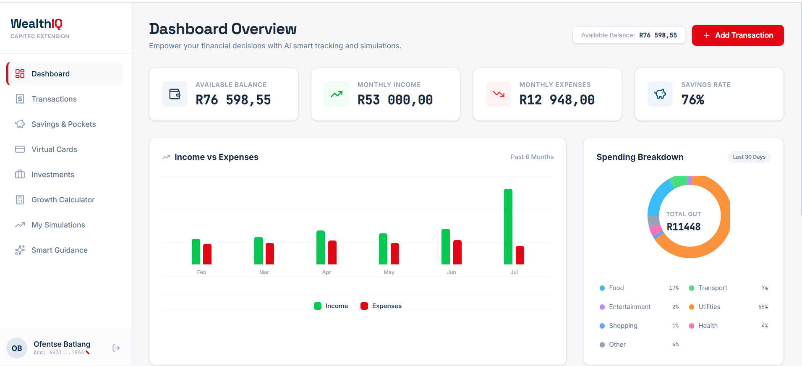
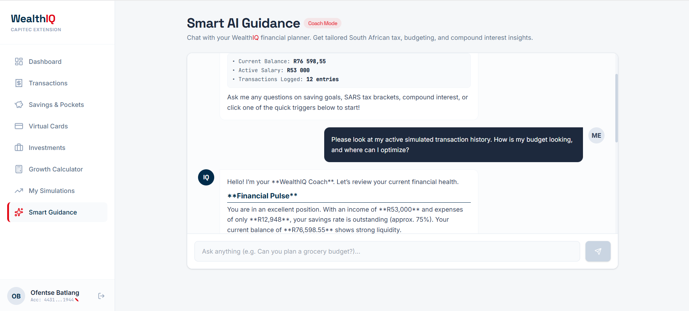
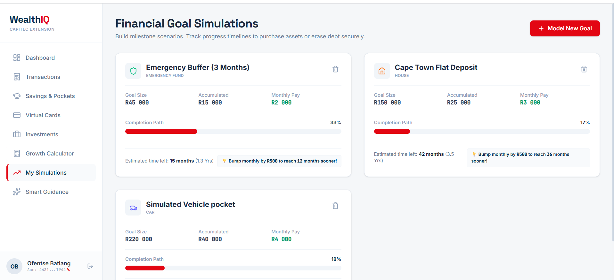
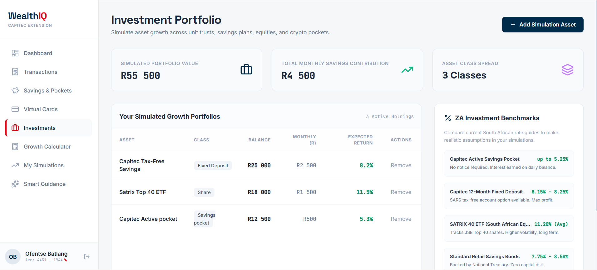
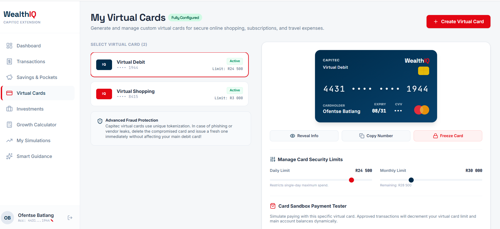

# 💳 WealthIQ: AI-Powered Financial Intelligence Platform

> **Advanced Diploma in Information & Communication Technology - Final Year Project**  
> **Sol Plaatje University**, Kimberley, South Africa  
> **Author:** Ofentse Batlang ([LinkedIn](https://www.linkedin.com/in/ofentse-batlang-1a8330277) | [GitHub](https://github.com/ofentsebatlat))

---

## 🌟 Project Overview
**WealthIQ** is an end-to-end intelligent personal finance and banking advisory platform designed to bridge everyday transaction tracking with automated budgeting, smart financial guidance, and interactive web assistance.

The platform combines a full-featured **Python & Django** financial processing backend with a modern **React & TypeScript** browser extension and analytics dashboard, powered by **Google Gemini AI** for real-time transaction categorization and financial insights.

---

## 📸 Platform Previews

<div align="center">
  <h3>📊 Financial Dashboard & Overview</h3>
  
</div>

<br />

<div align="center">
  <table>
    <tr>
      <td width="50%" align="center">
        <strong>🤖 AI Financial Assistant</strong><br/><br/>
        
      </td>
      <td width="50%" align="center">
        <strong>🎯 Financial Goal Tracking</strong><br/><br/>
        
      </td>
    </tr>
    <tr>
      <td width="50%" align="center">
        <strong>📈 Investments & Growth</strong><br/><br/>
        
      </td>
      <td width="50%" align="center">
        <strong>💳 Virtual Cards & Security</strong><br/><br/>
        
      </td>
    </tr>
  </table>
</div>

---

## 🏗️ Architecture & Features

### ⚙️ Backend (`backend/`)
- **Django & Python REST API**: Centralized transaction ledger, account management, and financial calculation engine.
- **Biometric & Face Authentication**: Integrated authentication workflows and PIN verification.
- **Data Persistence**: Relational schema handling transactions, budget envelopes, cards, and investment holdings.

### 🌐 Frontend & Extension (`frontend-extension/`)
- **React 19 & TypeScript**: Responsive dashboard interface built with Vite and Tailwind CSS.
- **Smart Extension Overlay**: Directly assists users during online banking sessions.
- **Google Gemini AI Integration**: Contextual financial coaching, spending breakdown, and anomaly detection.
- **Firebase Firestore**: Real-time notifications and synchronized banking state.

---

## 🛠️ Tech Stack

| Domain | Technologies |
| :--- | :--- |
| **Backend** | Python 3.13, Django, SQLite / PostgreSQL, Django REST Framework |
| **Frontend / Extension** | React 19, TypeScript, Vite, Tailwind CSS, Lucide Icons |
| **AI & Cloud** | Google Gemini API, Firebase Firestore |
| **Tooling** | Git, GitHub, Node.js, Bun |

---

## 🚀 Getting Started

### 1. Prerequisites
- Python 3.10+
- Node.js 18+ or Bun
- Git

### 2. Backend Setup (Django)
```bash
cd backend
python -m venv venv

# On Windows:
.\venv\Scripts\activate
# On Linux/macOS:
# source venv/bin/activate

pip install -r requirements.txt
python manage.py migrate
python manage.py runserver
```

### 3. Frontend / Extension Setup (React + Vite)
```bash
cd frontend-extension
npm install

# Configure environment variables in .env.local:
# VITE_GEMINI_API_KEY=your_gemini_key

npm run dev
```

---

## 📄 License & Attribution
Developed by **Ofentse Batlang** as part of the Advanced Diploma in Information & Communication Technology at **Sol Plaatje University**.
