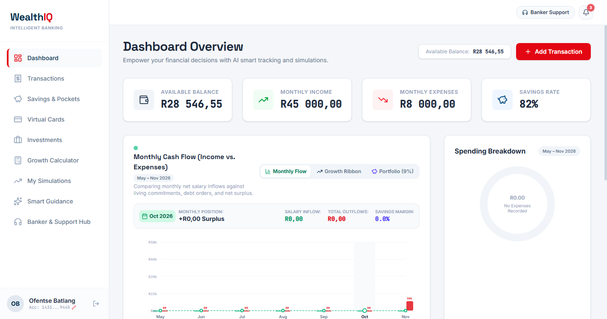
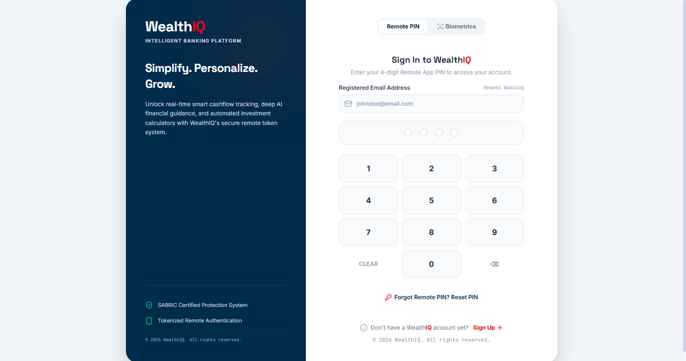
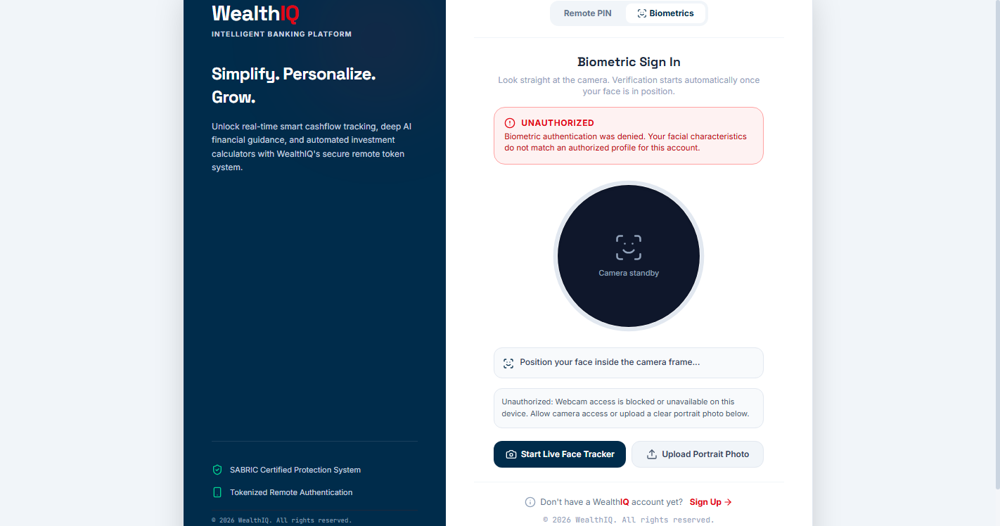
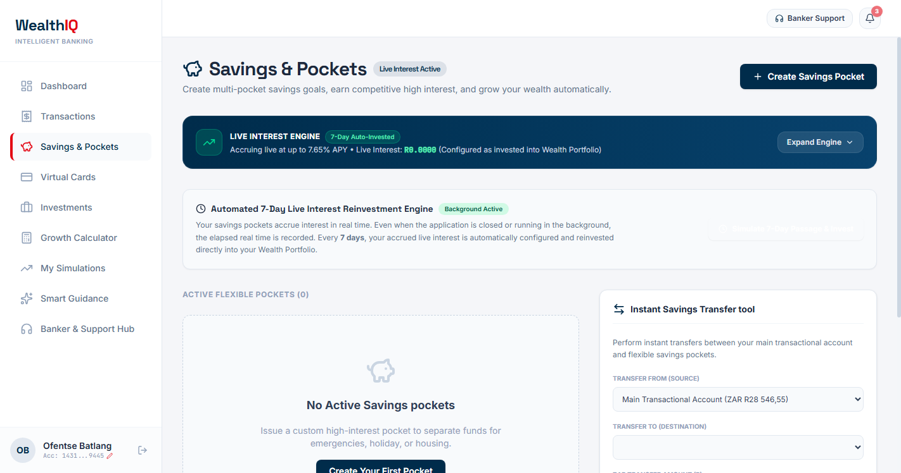
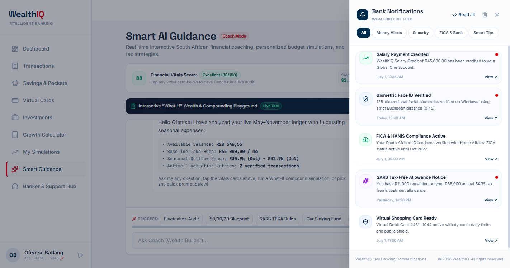
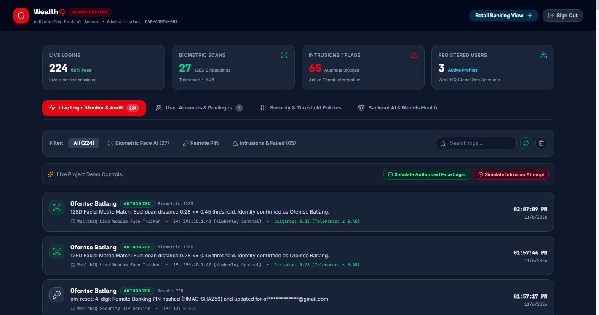
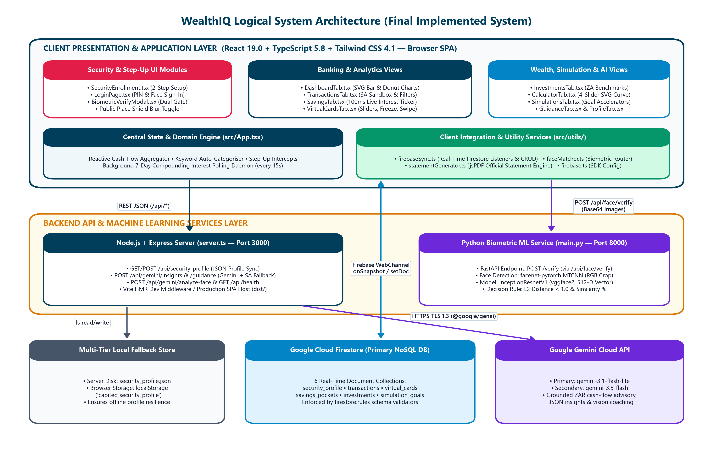

# 💳 WealthIQ: AI-Powered Financial Intelligence Platform

> **Advanced Diploma in Information & Communication Technology — Final Year Capstone Project (NPRJ740)**  
> **Sol Plaatje University**, Kimberley, South Africa  
> **Author:** Ofentse Batlang ([LinkedIn](https://www.linkedin.com/in/ofentse-batlang-1a8330277) | [GitHub](https://github.com/ofentsebatlat))  
> **Lecturer & Evaluator:** Dr. Silas Verkijika  
> **Academic Year:** 2026 | **Status:** Assessed Final Release

---

## 🌟 Project Overview
**WealthIQ** is an end-to-end intelligent personal financial management and biometric-authenticated digital banking extension platform inspired by Capitec's Global One aesthetic. The platform bridges everyday transaction accounting with automated cash-flow categorization, multi-pocket continuous yield compounding, tokenized virtual card management, and **3D liveness-verified computer vision biometrics**.

### Key Implemented Capabilities:
- 🔐 **Dual-Factor Authentication:** 4-digit Remote Banking PIN with SHA-256 password hashing and SABRIC-compliant 3-strike brute-force lockout defense.
- 👁️ **Computer Vision Biometrics & 3D EAR Liveness:** OpenCV & Dlib 68-point facial landmark tracking with physiological **Eye Aspect Ratio ($EAR < 0.22$)** blink verification to reject 2D presentation spoofs, generating 128D deep metric embeddings for sub-second matching.
- 📊 **Dynamic Balance Aggregation Engine:** Reactive ledger calculations ensuring zero mathematical divergence across views ($Available = Income - Expenses - Savings$).
- 📈 **Continuous Compounding Savings Pockets:** Real-time interest accrual counter compounding at Capitec's benchmark rate ($8.25\%$ p.a.) with automated 7-day recurring deposit schedules.
- 💳 **Tokenized Virtual Cards with Step-Up Security:** Skeuomorphic card faces with masked PAN/CVV, instant freeze toggle, and step-up facial biometric challenges for high-value actions ($>\text{R}2,000$).
- 🤖 **Hybrid AI Financial Coach:** Natural language advisory powered by **Google Gemini AI**, backed by offline rule-based South African tax (Section 12J, TFSA) and budgeting models.
- 🛡️ **SecOps Administration Portal:** Master control panel tracking live intrusion telemetry, biometric similarity audit logs, and account freeze overrides.

---

## 📸 Live Running System Gallery

<div align="center">
  <h3>📊 Financial Dashboard & Dynamic Cash-Flow Overview</h3>
  
</div>

<br />

<div align="center">
  <table>
    <tr>
      <td width="50%" align="center">
        <strong>🔐 Remote PIN Entry Keypad</strong><br/><br/>
        
      </td>
      <td width="50%" align="center">
        <strong>👁️ Live Biometric Face Scanner</strong><br/><br/>
        
      </td>
    </tr>
    <tr>
      <td width="50%" align="center">
        <strong>📈 Real-Time Savings & Pockets</strong><br/><br/>
        
      </td>
      <td width="50%" align="center">
        <strong>💳 Virtual Cards & Step-Up Security</strong><br/><br/>
        
      </td>
    </tr>
    <tr>
      <td width="50%" align="center">
        <strong>🤖 Hybrid AI Financial Coach</strong><br/><br/>
        
      </td>
      <td width="50%" align="center">
        <strong>🛡️ SecOps Admin & Intrusion Telemetry</strong><br/><br/>
        
      </td>
    </tr>
  </table>
</div>

---

## 🏛️ System Architecture

WealthIQ is architected as a decoupled, multi-tier service-oriented system:

<div align="center">
  
</div>

### Architectural Tiers:
1. **Presentation Layer (`frontend-extension/src/`):** React 19 Single-Page Application styled with Tailwind CSS, Lucide Banking Icons, Chart.js visualizers, and jsPDF statement export.
2. **Application Gateway (`frontend-extension/server.ts`):** Express & Node.js gateway hosting session middleware, local persistent JSON profiles, and reverse-proxying.
3. **Computer Vision Microservice (`frontend-extension/python-backend/`):** Python 3.12 microservice running OpenCV, Dlib, and NumPy for 68-point landmark tracking, Eye Aspect Ratio (EAR) blink detection, and 128D deep metric feature extraction.
4. **Data & Cloud Layer:** Google Cloud Firestore synchronized with local profile backups, and Google Gemini Pro Generative AI.

---

## 📚 Final Capstone Report & Documentation

The complete, unabridged **Final Capstone Project Report** adhering strictly to the **Sol Plaatje University NPRJ740 Template** is published directly within this repository:

- 📄 [**NPRJ740 Final Project Report — Final Submission (Word DOCX)**](docs/NPRJ740_Final_Project_Report_Ofentse_Batlang_202300977_Final_Submission.docx) — *Official SPU layout, high-res original diagrams, live screenshots, MoSCoW matrices, and APA 7th citations.*
- 📝 [**NPRJ740 Final Project Report (Markdown Source)**](docs/NPRJ740_Final_Project_Report.md) — *Full text (16,400+ words) covering all 11 required chapters.*
- 📐 [**System Architecture & Design Diagrams**](docs/diagrams/) — *High-fidelity diagrams including System Context, Use Cases, Workflows 1 & 2, Class Diagrams, ERD, and Deployment Topology.*

---

## 🛠️ Technology Stack

| Domain | Technologies & Libraries |
| :--- | :--- |
| **Frontend Runtime** | React 19, TypeScript, Vite, Tailwind CSS, Motion, Lucide React, Chart.js |
| **Application Gateway** | Node.js, Express, tsx, Nodemailer, jsPDF |
| **Computer Vision Engine** | Python 3.12, OpenCV (`cv2`), Dlib 68-Point Facial Regressor, NumPy |
| **AI Advisory Engine** | Google Gemini API (`@google/genai`), South African Tax Knowledgebase |
| **Data Persistence** | Google Cloud Firestore, In-Memory Ledger Aggregation, Persistent JSON Storage |
| **Testing & CI** | Node.js Test Harness, Jest / ts-node, Brutal Security Verification Suite |

---

## 🚀 Step-by-Step Setup & Operation

### 1. Prerequisites
- **Node.js** (v18.0.0 or higher) and `npm`
- **Python** (v3.10 to v3.12) with `pip`
- Modern Web Browser (Google Chrome recommended for WebRTC camera stream)

### 2. Application Installation
```bash
# Clone the repository
git clone https://github.com/ofentsebatlat/wealthiq-financial-platform.git
cd wealthiq-financial-platform/frontend-extension

# Install Node.js frontend & gateway dependencies
npm install
```

### 3. Initialize Python Computer Vision Backend
```bash
cd python-backend

# Create and activate virtual environment
python -m venv venv
# Windows:
.\venv\Scripts\activate
# Linux/macOS:
# source venv/bin/activate

# Install facial recognition dependencies
pip install -r requirements.txt
```

### 4. Start the Running Platform
```bash
# Return to frontend-extension root
cd ..

# Launch full platform (Express Gateway + Vite Dev Server on port 3000)
npm run dev
```

The application gateway automatically manages and spawns the Python Computer Vision microservice on port 8000. Access the platform at:
👉 **`http://localhost:3000`**

---

## 🔑 Pre-Configured Evaluation Credentials

| Account Role | Identifier / Email | Remote PIN | Capabilities |
| :--- | :--- | :--- | :--- |
| **Primary Retail Client** | `createaccount@gmail.com` | `1234` | Full access to Dashboard, Ledger, Pockets, Virtual Cards, Calculator, Goals, and AI Coach |
| **SecOps Master Admin** | `admin.secops@wealthiq.co.za` | `9999` or `0000` | Full administrative control, live intrusion audit logs, brute-force lockout overrides |

---

## 📄 Academic Attribution & License
Developed by **Ofentse Batlang** (Student No: `202300977`) in partial fulfillment of the requirements for the **Advanced Diploma in Information & Communication Technology** at **Sol Plaatje University**, Kimberley, South Africa.

Supervised by: **Dr. Silas Verkijika**, Department of Computer Science & Information Technology.
